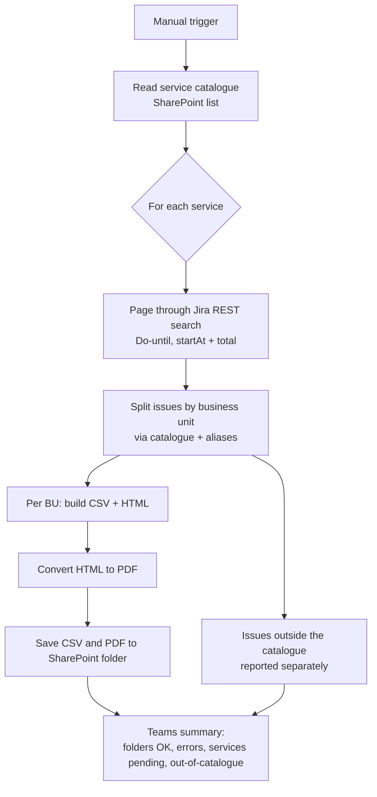
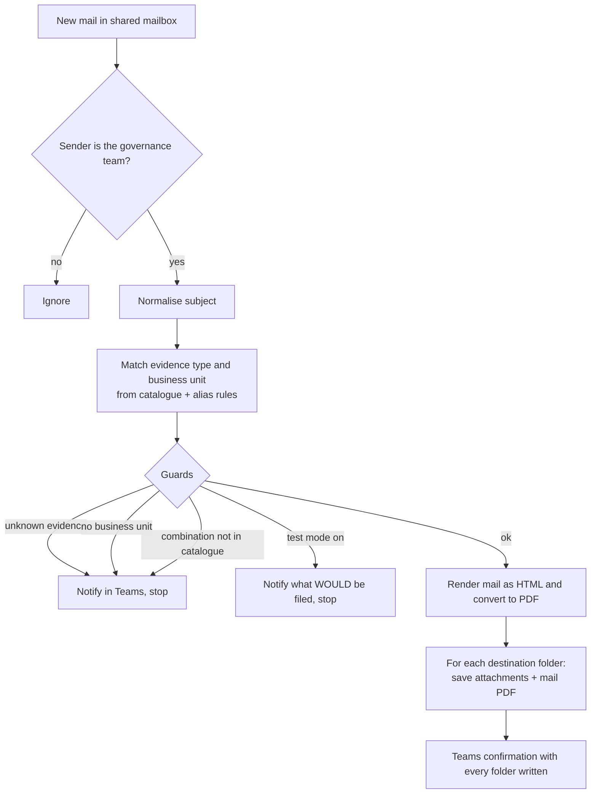

# Jira Evidence Automation (Power Automate)

Three cloud flows that automate the collection and archiving of **audit evidence**: extracting delivery evidence from Jira per service and business unit, and filing evidence that arrives by e-mail into a structured SharePoint library, with a Teams notification at the end of every run.

This repository documents the **design**: architecture, patterns and decisions. It is deliberately free of any company data, endpoints, site URLs or flow exports.

## The problem

Inter-company billing and governance reviews require proof that work was actually delivered, per service and per business unit. Collecting it was a manual loop: run a Jira search, export, split by business unit, convert to PDF, drop it in the right folder, and do the same for evidence sent by e-mail. It was slow, inconsistent, and different people filed things in different places.

## The flows

### 1. Evidence per service and business unit

Manual trigger. For every service in a catalogue (a SharePoint list), it pulls the matching Jira issues, splits them by business unit and writes a CSV and a PDF into the right folder.

### 2. Consolidated extract with validation

Same extraction pattern run for two Jira projects, producing a complete CSV plus PDF per project and then a per-business-unit breakdown. It also lists issues that could not be assigned to any known business unit so they can be corrected at source.

### 3. Evidence arriving by e-mail

Triggered when a mail lands in a shared mailbox (polled every 5 minutes). It reads the subject, works out **what** the evidence is and **which business unit** it belongs to, and archives the attachments plus a PDF copy of the e-mail.

## Design decisions worth calling out

- **Catalogue-driven, not hard-coded.** Services, business units, evidence types and aliases live in SharePoint lists. Adding a business unit is a data change, not a flow change.
- **Guards that fail loudly.** Every ambiguous case (unknown evidence, no business unit, combination missing from the catalogue) stops the run and posts a Teams message explaining why. A silent mis-filing is worse than a visible stop.
- **Test mode.** A flag makes the mail flow report where it *would* file things without writing anything, which is how new rules were validated against real mail.
- **Pagination done properly.** The Jira search loops with `startAt` until the returned total is covered, so large services are not silently truncated.
- **Idempotent, observable runs.** Each run counts folders saved, save errors, services without a query and services missing from the catalogue, and reports all four.
- **PDF via a temporary HTML file.** HTML is generated, converted with the file connector, saved, and the temporary file is deleted, so no residue is left in the library.
- **Normalisation.** Subjects and names are lower-cased, accent-stripped and sanitised for folder names, which removes a whole class of "same thing, different spelling" failures.

## Stack

Power Automate (cloud flows) · Jira Cloud/Server REST API · SharePoint lists and libraries · OneDrive · Microsoft Teams · Office 365 Outlook (shared mailbox)

## Author

Michel Urrutia Salgado · IT Project Manager & IT Governance · [LinkedIn](https://www.linkedin.com/in/michel-urrutia-salgado-9a4b3755/)
